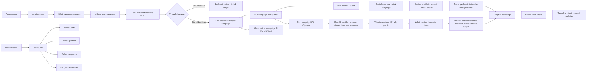

# Workflow Aplikasi Solusi Sejalan

Panduan ini menjelaskan alur penggunaan fitur yang tersedia saat ini: landing page, brief calon klien, pengelolaan lead, paket, campaign, partner, deliverable, analytics, studi kasus, pengguna, pengaturan, dan portal.

## Peta alur aplikasi

## Cara menggunakan

### 1. Siapkan informasi publik

1. Masuk melalui `/admin/login` memakai akun admin.
2. Buka **Paket** dan tambahkan paket layanan digital marketing: nama, harga, deskripsi, serta benefit.
3. Buka **Studi Kasus** untuk menambahkan hasil campaign yang sudah layak dipublikasikan.
4. Buka **Pengaturan** untuk mengatur identitas aplikasi, kontak, logo, favicon, dan informasi website.
5. Periksa landing page, halaman **Paket**, **Layanan**, dan **Studi Kasus** dari sisi pengunjung.

### 2. Terima dan tinjau brief

1. Calon klien membuka halaman **Brief** dari website.
2. Calon klien mengisi kontak, brand, tujuan campaign, audiens, kanal, kisaran budget, dan persetujuan penggunaan data.
3. Admin membuka **Brief** di dashboard untuk membaca kebutuhan dan menghubungi calon klien.
4. Perbarui status lead saat proses berjalan: baru, ditinjau, proposal, atau ditutup.
5. Jika sudah disepakati, gunakan aksi konversi untuk membuat campaign dari brief. Data tujuan, kontak, budget maksimum, dan tanggal target akan dibawa ke campaign.

### 3. Jalankan campaign

1. Buka **Campaign** dan pilih campaign hasil konversi, atau buat campaign baru jika tidak berasal dari brief.
2. Lengkapi judul, klien, tujuan, budget, tanggal, dan status. Status campaign yang tersedia: perencanaan, aktif, jeda, selesai, atau dibatalkan.
3. Pastikan partner sudah terdaftar di menu **Partner**. Hubungkan akun pengguna bertipe talent bila partner perlu mengakses portal.
4. Di detail campaign, buat **deliverable** untuk tiap tugas publikasi: judul, platform, partner, jadwal, tautan publikasi, dan catatan.
5. Perbarui status deliverable dari direncanakan menjadi dikerjakan lalu dipublikasikan. Isi reach, impressions, dan engagements setelah tersedia.

### 4. Pantau hasil dan tutup campaign

1. Klien masuk ke `/portal/client` untuk melihat campaign yang terhubung ke akun/email-nya.
2. Partner masuk ke `/portal/partner` untuk melihat deliverable yang ditugaskan ke profilnya.
3. Admin membuka **Analytics** untuk memantau rekap performa deliverable.
4. Tandai campaign selesai setelah pekerjaan dan pelaporan selesai.
5. Buat studi kasus dari hasil yang sudah disetujui untuk ditampilkan di website.

### 5. Jalankan campaign KOL Clipping

1. Saat membuat atau mengedit campaign, pilih jenis **KOL Clipping**.
2. Masukkan URL video sumber, brief yang jelas, rate per 1.000 views, cap khusus clipping, dan minimum views per klip. Cap clipping tidak boleh melebihi budget keseluruhan campaign.
3. Konfirmasi bahwa brand memiliki izin untuk memotong dan mendistribusikan materi sumber. Campaign tidak bisa disimpan sebagai KOL Clipping tanpa konfirmasi ini.
4. Aktifkan campaign. Talent dengan akun yang terhubung ke profil partner aktif akan melihat program di `/portal/partner`.
5. Clipper membaca aturan, mengunggah klip ke akun sosialnya, lalu mengirim judul, platform, dan URL posting publik melalui portal.
6. Admin/account manager membuka detail campaign, memeriksa posting dan kesesuaiannya, lalu memasukkan jumlah views dari bukti/platform.
7. Setujui atau tolak kiriman. Reward dihitung sebagai rate per 1.000 views, mengikuti minimum per klip, dan persetujuan ditolak jika melewati cap budget.
8. Analytics merangkum kiriman, klip yang disetujui, views, dan estimasi reward. Pembayaran aktual tetap dicatat di luar aplikasi.

### 6. Kelola akses dan operasional

- **Pengguna**: buat akun dan tetapkan peran admin, account manager, client, atau talent. Password awal mengikuti aturan aplikasi saat ini.
- **Keamanan**: tinjau aktivitas/sesi dan pengamanan akun melalui menu Keamanan.
- **Pengaturan**: sesuaikan brand dan konfigurasi aplikasi. Perubahan aset brand digunakan bersama oleh halaman publik dan admin.
- **CRUD**: di halaman data admin yang mendukungnya, gunakan **Tambah** untuk membuat data, **Edit** untuk memperbarui, dan **Hapus** untuk menghapus. Pastikan data yang benar sebelum menghapus.

## Peran pengguna

| Peran | Penggunaan utama |
|---|---|
| Pengunjung / calon klien | Melihat layanan dan paket, lalu mengirim brief. |
| Admin utama | Mengelola seluruh area, termasuk pengguna, pengaturan website, branding, dan antrean notifikasi. |
| Account manager | Mengelola operasional campaign, lead, partner, paket, deliverable, analytics, dan studi kasus; pengaturan global serta manajemen pengguna hanya untuk admin utama. |
| Klien | Melihat campaign yang terhubung di Portal Client. |
| Talent / partner | Melihat deliverable yang ditugaskan di Portal Partner. |

## Catatan cakupan saat ini

Portal klien saat ini menampilkan ringkasan campaign. Portal partner menampilkan deliverable dan tautan publikasi. Persetujuan materi, invoice/pembayaran, percakapan, dan unggah bukti/asset belum menjadi bagian dari alur yang tersedia saat ini; jangan mengandalkan portal sebagai fitur untuk hal-hal tersebut.
